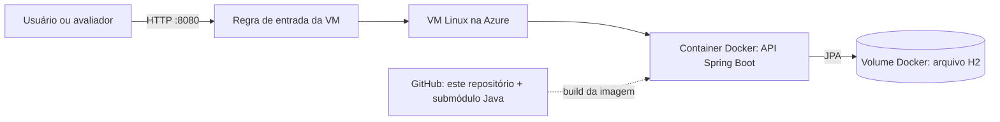

# REACTIO Cloud

Entrega de DevOps Tools & Cloud Computing para demonstrar a API Java do REACTIO em um container Docker executado em uma VM Linux na Microsoft Azure.

## Integrantes

| Nome | RM | Turma |
| --- | --- | --- |
| Kayque Duarte | 567980 | 2TDSPB |
| Eric Maciel Martins | 567398 | 2TDSPB |
| Gabriel Correa | 567903 | 2TDSPB |

## Escopo desta entrega

Este repositório cuida da execução e da infraestrutura demonstrativa. O código da API continua no [repositório Java original](https://github.com/Kayque2012/REACTIO-java) e é referenciado aqui como submódulo em `api/REACTIO-java`.

A aplicação é uma API REST Spring Boot 3.5 / Java 17. Ela fornece CRUD editorial de afirmações e endpoints de quiz com feedback e fontes. O banco H2 em arquivo é mantido em um volume Docker. Login e persistência das tentativas não fazem parte da API Java desta Sprint.

## Arquitetura simplificada



O container publica a porta `8080`. O arquivo do H2 fica no volume `reactio-data`, separado do ciclo de vida do container. A VM executa a mesma imagem que pode ser construída localmente.

## Pré-requisitos

- Git com suporte a submódulos;
- Docker Desktop ou Docker Engine;
- Para a etapa de nuvem: Azure CLI e acesso a uma assinatura Azure.

## Obter o projeto

Clone este repositório inicializando o submódulo da API:

```bash
git clone --recurse-submodules https://github.com/Eric-devops-tech/Reactio-Cloud.git
cd Reactio-Cloud
```

Se o repositório já foi clonado sem o submódulo:

```bash
git submodule update --init --recursive
```

## Construir e executar com Docker

Na raiz deste repositório:

```bash
docker build -t reactio-api:local .
docker volume create reactio-data
docker run --name reactio-api -p 8080:8080 -v reactio-data:/app/data reactio-api:local
```

Verifique a API em `http://localhost:8080/swagger-ui.html` e `http://localhost:8080/api/quiz`. Para interromper o container, use `docker stop reactio-api`. O volume `reactio-data` preserva o arquivo H2 entre recriações do container.

O Dockerfile compila a API Java 17 em uma etapa Maven e copia o JAR para uma imagem de execução Java 17. O processo roda como usuário sem privilégios e a aplicação escuta em `0.0.0.0` dentro do container.

## Azure CLI

Os comandos para provisionar uma VM, executar o container e remover os recursos estão em [docs/azure-cli.md](docs/azure-cli.md). A VM é criada sem regras de entrada; o roteiro adiciona acesso restrito ao IP do demonstrador para a porta `8080`.

## Como Docker e Cloud Computing podem ser utilizados na solução proposta pelo grupo?

O Docker empacota a API Java e suas dependências em uma imagem reproduzível, reduzindo diferenças entre o computador de desenvolvimento e o ambiente de demonstração. A Azure fornece a VM Linux e a rede para executar esse container e disponibilizar os endpoints da API. Um volume Docker mantém os dados do H2 quando o container é recriado.

## Entregas finais da disciplina

- [x] Dockerfile da API;
- [x] Arquitetura simplificada;
- [x] Instruções para reproduzir a execução;
- [ ] Evidências da VM Azure criada via Azure CLI e container em execução;
- [ ] Link do vídeo demonstrativo não listado (até 3 minutos, mínimo 720p);
- [ ] PDF final com integrantes, RMs, turma e links do GitHub e do vídeo.

## Observação de segurança

A API Java desta Sprint não autentica os endpoints editoriais. No roteiro de nuvem, a porta `8080` fica acessível apenas ao IP do demonstrador durante a apresentação. Remova o grupo de recursos ao concluir a demonstração.
