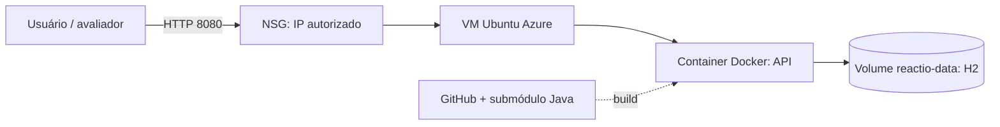

# REACTIO Cloud

Entrega da disciplina Cloud Computing, de Carlos Miguel: API Java do REACTIO em container Docker numa VM Linux Azure.

## Integrantes

| Nome | RM | Turma |
| --- | --- | --- |
| Eric Maciel | 567398 | 2TDSPB |
| Gabriel Correa | 567903 | 2TDSPB |
| Kayque Duarte | 567980 | 2TDSPB |

## Escopo e arquitetura

Este repositório contém os arquivos Cloud. A API permanece no [repositório Java original](https://github.com/Kayque2012/REACTIO-java), referenciado no submódulo `api/REACTIO-java`. A API Spring Boot 3.5 / Java 17 oferece CRUD editorial e endpoints de quiz. O banco H2 em arquivo usa volume Docker.



## Ambiente Azure usado na demonstração

Provisionado em 03/11/2026 via Azure CLI: grupo `rg-reactio-cloud-demo-20261103`; VM `vm-reactio-demo`; Ubuntu 22.04; Chile Central, zona 3; `Standard_B2s_v2` (2 vCPU, 8 GiB). A API foi demonstrada na porta 8080, com acesso limitado ao IP autorizado. Após a gravação do vídeo, o grupo de recursos e a VM foram excluídos para encerrar os custos. A infraestrutura pode ser recriada seguindo [docs/azure-cli.md](docs/azure-cli.md).

Vídeo demonstrativo: [REACTIO - Cloud Computing](https://youtu.be/KybD_mHrX5M)

## Obter e executar localmente

```bash
git clone --recurse-submodules https://github.com/Eric-devops-tech/Reactio-Cloud.git
cd Reactio-Cloud
docker build -t reactio-api:local .
docker volume create reactio-data
docker run --name reactio-api -p 8080:8080 -v reactio-data:/app/data reactio-api:local
```

Acesse `http://localhost:8080/api/quiz` ou `http://localhost:8080/swagger-ui.html`. Requisitos: Git com submódulos, Docker e Azure CLI para a etapa de nuvem.

## Azure CLI

Veja [docs/azure-cli.md](docs/azure-cli.md) para provisionamento, instalação do Docker, comandos de verificação, histórico e limpeza. Arquitetura: [docs/arquitetura.md](docs/arquitetura.md).

## Arquivos para reprodução

- [`Dockerfile`](Dockerfile) e [`.dockerignore`](.dockerignore): construção da imagem da API;
- [`docs/azure-cli.md`](docs/azure-cli.md): comandos Azure CLI para criar a infraestrutura, implantar e verificar o container, e excluir os recursos;
- [`docs/arquitetura.md`](docs/arquitetura.md): diagrama e descrição dos componentes;
- submódulo [`api/REACTIO-java`](api/REACTIO-java): código-fonte Java necessário para construir a imagem.

## Como Docker e Cloud Computing podem ser utilizados na solução proposta pelo grupo?

O Docker empacota a API Java e suas dependências em uma imagem reproduzível, reduzindo diferenças entre o desenvolvimento local e a demonstração. A Azure fornece a VM Linux e a rede para executar e disponibilizar o container. O volume Docker mantém os dados do H2 quando o container é recriado.

## Entregas

- [x] Dockerfile, arquitetura e instruções Azure CLI
- [x] VM criada via CLI e container em execução
- [x] Vídeo demonstrativo não listado no YouTube (até 3 min, mínimo 720p)
- [ ] PDF final com integrantes, RMs, turma, repositório e vídeo

O grupo dedicado já foi removido após a gravação. Para repetir a demonstração no Azure, use os comandos de provisionamento em [docs/azure-cli.md](docs/azure-cli.md). Ao terminar uma nova execução, remova o grupo para encerrar os recursos e custos:

```powershell
az group delete --name rg-reactio-cloud-demo-20261103 --yes --no-wait
```
Confira o nome antes da exclusão. O grupo automático `NetworkWatcherRG` não pertence ao projeto.
