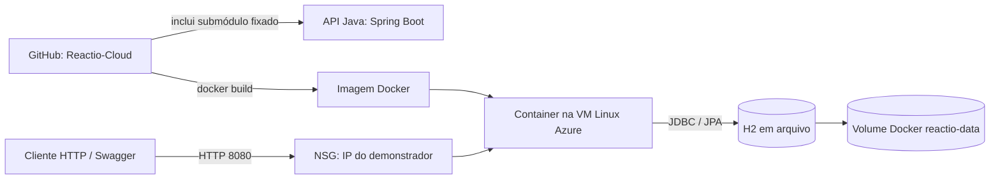

# Arquitetura da demonstração Cloud

## Componentes

| Componente | Responsabilidade |
| --- | --- |
| API Spring Boot | Fornece conteúdo editorial e avalia respostas do quiz. |
| Repositório Java original | Mantém o código-fonte da API; este repositório o referencia por submódulo. |
| Docker | Empacota a aplicação Java 17 e mantém o processo isolado. |
| VM Linux Azure | Executa o container para a demonstração da disciplina. |
| NSG | Restringe a entrada na porta 8080 ao IP do demonstrador. |
| Volume Docker | Persiste o arquivo H2 fora do container. |

## Fluxo

1. O Git clona o repositório Cloud e inicializa o submódulo Java.
2. O Dockerfile compila o JAR com Maven e Java 17.
3. O container executa o JAR na porta 8080 e monta o volume em `/app/data`.
4. O avaliador acessa Swagger ou os endpoints de quiz pelo IP público da VM, conforme a regra de rede temporária.

Esta arquitetura é uma demonstração acadêmica de uma única VM. Não inclui alta disponibilidade, domínio, TLS, balanceador, autenticação de usuários ou banco gerenciado.
