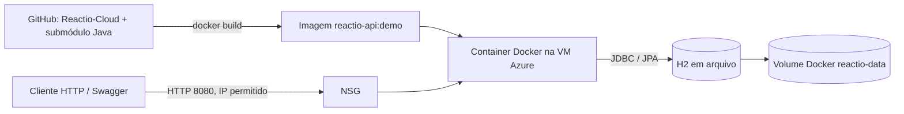

# Arquitetura da demonstração Cloud

## Recursos atuais

Provisionados em 03/11/2026 pela Azure CLI:

| Recurso | Detalhes |
| --- | --- |
| Grupo | `rg-reactio-cloud-demo-20261103` |
| VM | `vm-reactio-demo`, Ubuntu Server 22.04 LTS |
| Região / zona | Chile Central / 3 |
| Tamanho | `Standard_B2s_v2`, 2 vCPU, 8 GiB |
| NSG | TCP 8080 apenas para o IP autorizado; sem SSH público |
| Container | API Spring Boot Java 17, porta 8080 |
| Volume | `reactio-data`, arquivo H2 em `/app/data` |

A VM clona o repositório Cloud e seu submódulo Java, constrói a imagem Docker e inicia o container. O Azure Run Command permite administrar a VM sem expor SSH.

É uma demonstração acadêmica em uma única VM. Não inclui alta disponibilidade, domínio, TLS, balanceador, autenticação de usuário ou banco gerenciado. A API não autentica operações editoriais; mantenha o NSG restrito e remova o grupo após a demonstração.
